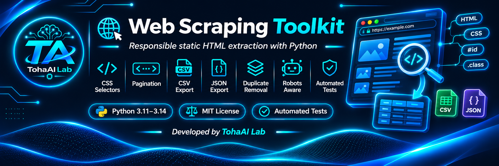

# Web Scraping Toolkit

### Responsible static HTML extraction with Python

[](https://github.com/TohaAI-Lab/web-scraping-toolkit/actions/workflows/tests.yml)


Developed by **TohaAI Lab**.

A small command-line toolkit for extracting structured records from authorized, static HTML pages. It combines configurable CSS selectors, limited pagination, duplicate removal and UTF-8 CSV/JSON output.

## Features

- Extract text and HTML attributes using CSS selectors.
- Collect sequential pages on the same HTTP(S) origin.
- Stop at the page limit, missing next link or a detected cycle.
- Remove duplicate records by their selected field values.
- Check common robots.txt rules before requesting pages.
- Set request pacing, connection/read timeouts and bounded retries.
- Stop on access denials and redirects; honor bounded Retry-After waits.
- Limit decoded response size to 2 MiB per response and unique records to 100,000.
- Export JSON or CSV (with basic spreadsheet formula-injection mitigation).
- Write the output only after collection succeeds, using atomic file replacement.
- Run automated tests without external websites.

## Requirements

Python 3.11 or newer is the intended support range; see CI for verified versions. The direct dependencies are Requests, Beautiful Soup and Soup Sieve, pinned to the versions used when preparing this project. A full transitive dependency lock and security audit are not included.

## Installation

```bash
git clone https://github.com/TohaAI-Lab/web-scraping-toolkit.git
cd web-scraping-toolkit
python3 -m venv .venv
source .venv/bin/activate
python -m pip install -r requirements.txt
```

On Windows, activate with `.venv\Scripts\Activate.ps1` in PowerShell, or use `.venv\Scripts\python.exe` directly.

## Quick start — local demonstration

The repository includes a fictional two-page product catalog. No external site is required. In a terminal at the project root, run:

```bash
python -m http.server 8765 --bind 127.0.0.1 --directory examples
```

In a second terminal with the virtual environment activated, run:

```bash
python scraper.py http://127.0.0.1:8765/index.html --item '.product' --field 'name=h2' --field 'price=.price' --field 'link=a::attr(href)' --next '.next' --max-pages 2 --format json --output output/products.json
```

For CSV, replace `--format json --output output/products.json` with `--format csv --output output/products.csv`. Stop the demo server with Ctrl+C when finished.

Expected output: three unique records from four matches, with the repeated Mouse record removed. See [example JSON](examples/sample.json) and [example CSV](examples/sample.csv). Prices and links are fictional; attribute values are returned as written, not resolved to absolute URLs.

## CLI options

| Option | Meaning | Default |
|---|---|---|
| `url` | Starting HTTP(S) URL | Required |
| `--item` | Repeating record CSS selector | Required |
| `--field` | `NAME=CSS` or `NAME=CSS::attr(href)`; repeat for each field | Required |
| `--next` | Next-page anchor CSS selector | None |
| `--max-pages` | Maximum pages (1–100) | 1 |
| `--delay` | Minimum interval between request starts (1–60 seconds) | 1 |
| `--timeout` | Connection and read timeout (1–60 seconds) | 15 |
| `--retries` | Additional attempts on selected transient errors (0–3) | 2 |
| `--format` | `json` or `csv` | json |
| `--output` | Destination file, matching format extension | Required |

Missing selected fields become empty strings. Selectors are relative to each matching record. CSV output adds an apostrophe before potentially dangerous formula values; JSON retains original values. Existing output is replaced after successful collection; choose your destination carefully. If collection fails, the command exits nonzero and leaves existing output untouched.

## Architecture

```text
scraper.py             CLI and orchestration
scraping/
  __init__.py           Package version
  core.py              HTTP client, pacing, retries, robots rules
  extract.py           CSS extraction, pagination and deduplication
  export.py            JSON and CSV export
examples/              Fictional HTML pages, robots.txt and sample exports
tests/                 Offline unit and local HTTP integration tests
.github/workflows/     Automated CI
```

## Responsible use and limitations

- Only collect content you have permission to access; respect the site's terms, privacy and applicable law. robots.txt is not a grant of permission.
- The robots implementation handles common ASCII path rules, wildcards, end anchors, matching agent groups and crawl-delay. It is **not a complete RFC 9309 implementation**. Unsupported selected rule encodings, request-rate directives and excessive delays stop collection; ambiguous URL encoding under applicable rules is denied. A 404/410 robots response is treated as absence of a policy; other failures stop collection. Redirects, including robots redirects, are not followed.
- Static HTML only: no JavaScript rendering, login, CAPTCHA bypass or proxy rotation.
- UTF-8 is assumed if no explicit charset is provided. Other encodings may require adaptation.
- Single-process sequential collection; no distributed rate coordination. Connection/read timeouts are not a total wall-clock deadline. There is no production-scale benchmark.
- Intended for a trusted operator on a local machine; **not an untrusted URL-fetching web service**. Local/private addresses are permitted for the demo. No SSRF protection or DNS pinning is implemented.
- CSV mitigation is not a guarantee against every spreadsheet implementation; treat exported content as untrusted.
- External website behavior and broad robots interoperability have not been validated. This is an initial development release.
- Keep collected personal or confidential data out of public repositories; the demo data is fictional.

## Tests

```bash
python -m unittest discover -s tests -v
```

The suite contains 25 tests covering CSS extraction, pagination, deduplication, URL validation, robots policies, retry handling, response limits, exports and a real loopback HTTP demonstration. External network calls are mocked or absent. GitHub Actions checks Python 3.11–3.14; the badge shows CI status rather than implying production readiness.

## License

MIT — see [LICENSE](LICENSE).

---
**TohaAI Lab** — Build. Automate. Improve.
